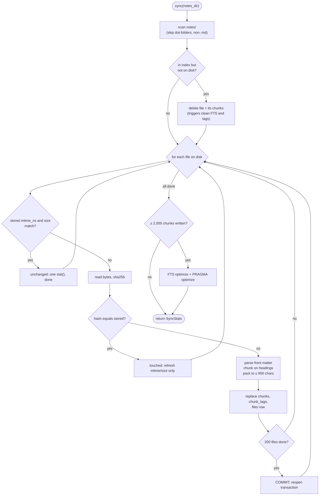
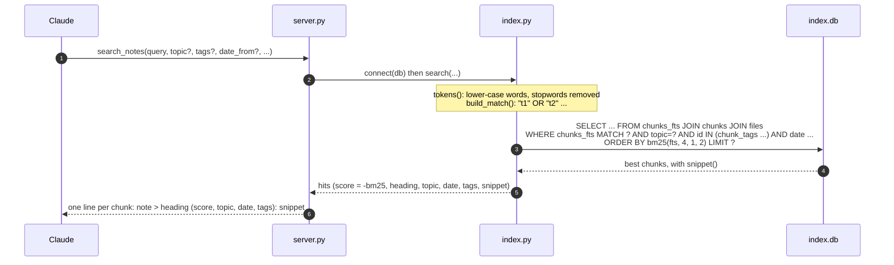
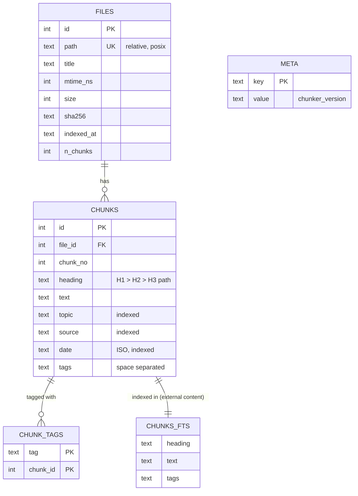
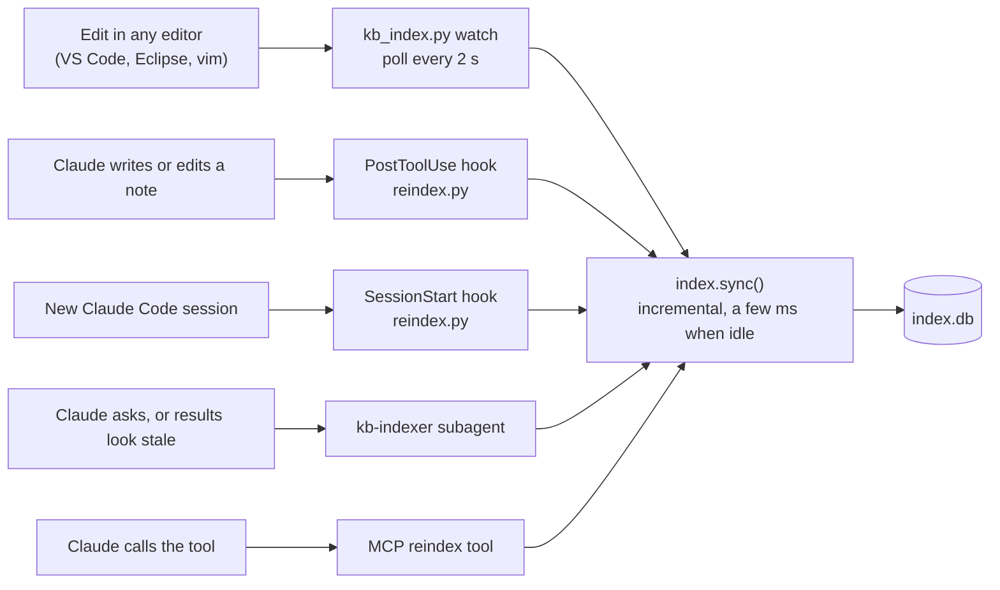

# Architecture

The knowledge-base server lets Claude Code search my personal course notes. Notes are markdown files in
`notes/`. A SQLite FTS5 index over their chunks is kept in step with the files, and Claude reads it through
an MCP server over stdio. Nothing leaves the machine except what Claude Code already sends to Anthropic.

## 1. Components

```mermaid
flowchart LR
    subgraph Claude["Claude Code (client)"]
        LLM["Claude"]
        HOOKS["Hooks<br/>.claude/settings.json"]
        AGENT["kb-indexer subagent<br/>.claude/agents/"]
        CMD["/learned, /save-discussion<br/>.claude/commands/"]
    end

    subgraph MCP["MCP server (stdio) : server.py"]
        TOOLS["Tools<br/>list_notes · search_notes<br/>get_note · reindex · index_stats"]
    end

    subgraph CORE["Logic (no MCP imports)"]
        IDX["index.py<br/>chunking · FTS5 · sync · search"]
        CORELIB["core.py<br/>list / get notes, note-level search"]
    end

    CLI["kb_index.py CLI<br/>sync · rebuild · watch · search · stats"]
    WATCH["watch loop<br/>(polls notes/ every 2 s)"]

    NOTES[("notes/*.md<br/>source of truth")]
    DB[("`.kb/index.db`<br/>SQLite FTS5, WAL")]
    EVALS["evals/run_eval.py<br/>31 questions"]
    TESTS["tests/test_index.py<br/>14 unit tests"]

    LLM -- "tool calls" --> TOOLS
    TOOLS --> IDX
    TOOLS -- "get_note" --> CORELIB
    CORELIB -- "reads" --> NOTES
    CORELIB -- "search via" --> IDX
    IDX -- "reads / writes" --> DB
    IDX -- "scans, hashes, reads" --> NOTES

    HOOKS -- "SessionStart, PostToolUse(Write|Edit)" --> SYNC_HOOK["reindex.py"]
    SYNC_HOOK --> IDX
    AGENT -- "runs" --> CLI
    WATCH --> IDX
    CLI --> IDX
    EVALS --> CORELIB
    EVALS --> IDX
    TESTS --> IDX
```

| Part | File | Role |
|---|---|---|
| MCP server | `mcp-servers/knowledge-base/server.py` | Five tools for Claude. Syncs once at startup. Logs to stderr only, because stdout carries the protocol. |
| Index engine | `mcp-servers/knowledge-base/index.py` | Parses front matter, chunks markdown, owns the SQLite schema, runs incremental sync and BM25 search. |
| Note logic | `mcp-servers/knowledge-base/core.py` | Lists and reads notes; `search_notes` collapses chunk hits to the best chunk per note. Used by the evals. |
| CLI | `mcp-servers/knowledge-base/kb_index.py` | Command-line front end for sync, rebuild, watch, search and stats. |
| Hooks | `.claude/hooks/reindex.py`, `check_evals.py` | `reindex.py` syncs on session start and after Claude edits a note. `check_evals.py` blocks a stop if the evals fail. |
| Subagent | `.claude/agents/kb-indexer.md` | Lets Claude sync, verify or rebuild the index on request. |
| Client config | `.mcp.json` | Starts the server with the arm64 venv Python via `arch -arm64`. |

## 2. Indexing pipeline (incremental sync)

Every trigger (hook, watcher, subagent, MCP `reindex`, CLI) calls the same `index.sync()`. Each file is handled
by the cheapest check that proves it is unchanged.



Important rules:
- **Hash only when needed.** mtime and size are the fast check. The sha256 check stops a `touch` from re-chunking.
- **`CHUNKER_VERSION`.** When it changes, `connect()` clears every stored hash, so the next sync re-chunks everything.
- **One transaction per batch.** A first build commits every 200 files, so the write lock is never held for long.
- **Failures roll back.** An exception rolls back the open transaction and is re-raised. The watcher logs it and retries on the next tick.

## 3. Query path



- **No query, filters only.** The same `WHERE` clause runs without `MATCH`, ordered newest first.
- **Filter placement.** Filters are SQL on indexed columns, so they combine with the text match and shrink the candidate set.
- **Ranking.** BM25 with weights 4 for heading, 1 for body text and 2 for tags. Porter stemming and prefix indexes (2 and 3 characters) are enabled.
- **Note-level search** (`core.search_notes`) keeps the best chunk per note. The evals use this shape.

## 4. Data model (`.kb/index.db`)



- `CHUNKS_FTS` stores no copy of the text. Triggers on `chunks` keep it in step on insert, update and delete.
- `CHUNK_TAGS` holds one row per tag, which makes "has all of these tags" an exact lookup.
- Front matter sets `topic`, `source`, `date` and `tags`. Without it, the defaults are the first sub-folder, the file path, and the file's modified date.

## 5. How the index stays current



All five paths call the same function, so overlap is harmless: a second sync finds nothing to do.

## 6. Quality gates

| Gate | Command | When it runs | Current result |
|---|---|---|---|
| Unit tests | `python3 -m unittest discover -s tests` | By hand, and before any commit | 14 pass |
| Search evals | `python3 evals/run_eval.py` | Stop hook (blocks the stop on failure), and by hand | 31/31 top-1 and top-3 |
| Benchmark | `python3 evals/bench_index.py` | By hand, on a synthetic corpus | see table below |

Benchmark on this laptop (50,000 chunks, 114 MB index, synthetic data):

| Operation | Time |
|---|---|
| Initial build | 7.7 s |
| Sync with no changes (2,000 files) | 13 ms |
| Sync after one edit or add | about 15 ms |
| Content-word query, median / 95th percentile | 0.6 ms / 1.5 ms |
| Worst case: common-word query only | 20–40 ms |

## 7. Design decisions

- **Standard library for the index.** The index needs only `sqlite3` with FTS5, which is built in. The server also needs the `mcp` package. Evaluation and benchmarks run without it.
- **Chunks, not files.** A chunk fits in a single answer, and BM25 favours a matching heading over a long file that happens to contain the words.
- **Polling watcher, not a file-system library.** Polling every 2 s costs one `stat()` per note and avoids a dependency.
- **Core logic separate from MCP.** `index.py` and `core.py` import nothing from `mcp`, so they can be tested alone and swapped (for example, for vector search) without changing the tools.
- **Pinned `mcp` 1.x.** The 2.x release renamed `FastMCP`.
- **arm64 via `arch -arm64`.** My shell runs under Rosetta, so the venv must be native arm64 to install `cryptography`.

## 8. Known limits

- **Keyword search only.** Matching is lexical: a paraphrase with no shared words will miss. Vector search is the planned next step, and the index is designed so it can sit alongside BM25.
- **Worst-case queries.** A query whose words appear in most chunks is slowest, because BM25 scores every match.
- **Watcher is manual.** It runs only when started. The hooks and the MCP startup sync cover normal use.
- **Synthetic benchmark.** The timings come from generated data. Real notes will differ.
- **Front matter is simple.** It accepts only `key: value` lines and an inline `[a, b]` list for tags.

## 9. Work in progress
- **Learnings** - as I am learning will keep adding more notes and test the performance
- **Planned Action 1 ** - Plan for embeddings when you need them. May have to store vectors in sqlite-vec or a similar extension so everything stays in one file.
- **Planned Action 2 ** - zFor tuning a small set of 20 to 50 real questions with the notes I expect to be retrieved.
